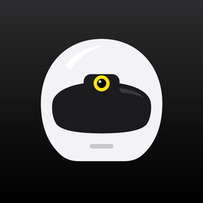
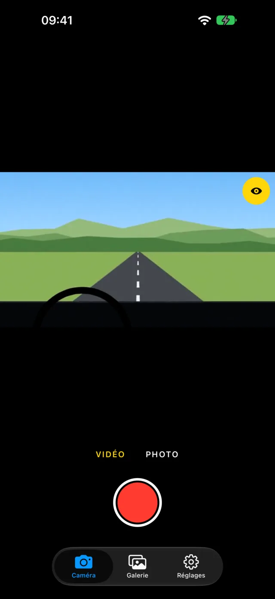
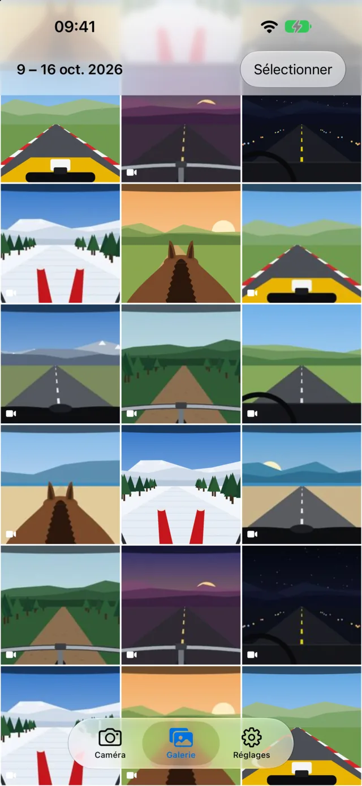
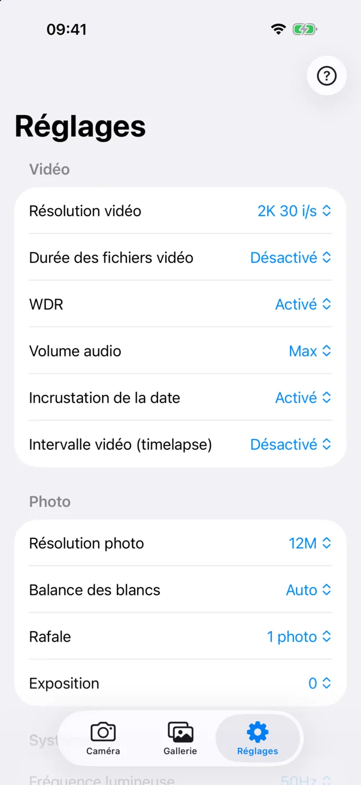

<p align="center">
  
</p>

<h1 align="center">Caméra Casque</h1>

<p align="center">
  Application iPhone et Android, libre et gratuite, <strong>compatible Cambox V3+</strong>.<br>
  Aperçu en direct, enregistrement, galerie et réglages de votre caméra casque.
</p>

<p align="center">
  <a href="https://cameracasque.fr/">Site</a> ·
  <a href="https://github.com/nicocha/cameracasque/releases/latest">Télécharger</a> ·
  <a href="https://github.com/nicocha/cameracasque/issues">Signaler un problème</a>
</p>

<p align="center">
  
  
  
</p>

## Pourquoi

Cambox a fermé et son application a disparu de l’App Store et de Google Play. Les caméras, elles, fonctionnent
toujours. Caméra Casque est une app indépendante, écrite de zéro à partir du protocole WiFi de la caméra
(Novatek), pour que les possesseurs de Cambox V3+ puissent continuer à s’en servir.

## Fonctions

- Aperçu en direct pour cadrer, enregistrement vidéo et photo à distance
- Galerie de la carte SD façon Photos : lecture, balayage entre les éléments, enregistrer dans Photos, partager, supprimer (sélection multiple)
- Tous les réglages de la caméra (résolution, durée des fichiers, WDR, exposition, WiFi…), batterie et firmware
- Aide intégrée tirée du manuel, mode clair et sombre
- Aucune donnée collectée : l’app ne parle qu’à la caméra, sur son réseau WiFi

## Compatibilité

| | |
|---|---|
| Caméra | Cambox V3+ (firmware V1.26A testé), Cambox V4 / V4 Plus / V4 Pro (V4 Pro firmware 1.2.7 testé) |
| iPhone | iOS 16.4 ou plus récent |
| Android | Android 8 ou plus récent |

## Structure du dépôt

```
app/    l’application (Expo / React Native) — voir app/README.md
docs/   le site web, publié par GitHub Pages (dossier /docs de la branche main)
```

## Compiler

```sh
cd app
npm install
npx expo run:ios --device       # iPhone branché
npx expo run:android --device   # téléphone Android branché
```

Builds de production et publication sur les stores : EAS (`app/eas.json`), détails dans `app/README.md`.

## Contribuer

Les tickets et les pull requests sont les bienvenus. Avant d’envoyer une modification :
`npx tsc --noEmit` et `node src/camera.check.ts` dans `app/`.

## Licence et marques

Code sous licence [MIT](LICENSE).

Caméra Casque est un projet indépendant, non affilié à Cambox Vision et non approuvé par elle.
Cambox® est une marque de Cambox Vision, citée uniquement pour indiquer la compatibilité.
Le manuel et les applications d’origine de Cambox ne sont pas distribués dans ce dépôt.
