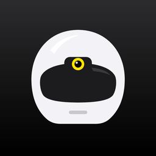
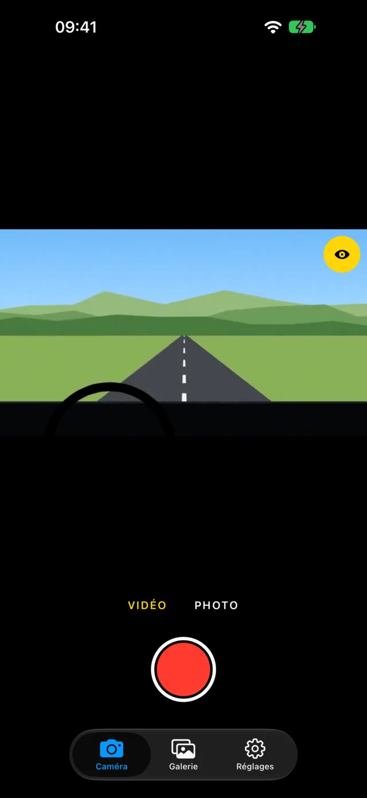
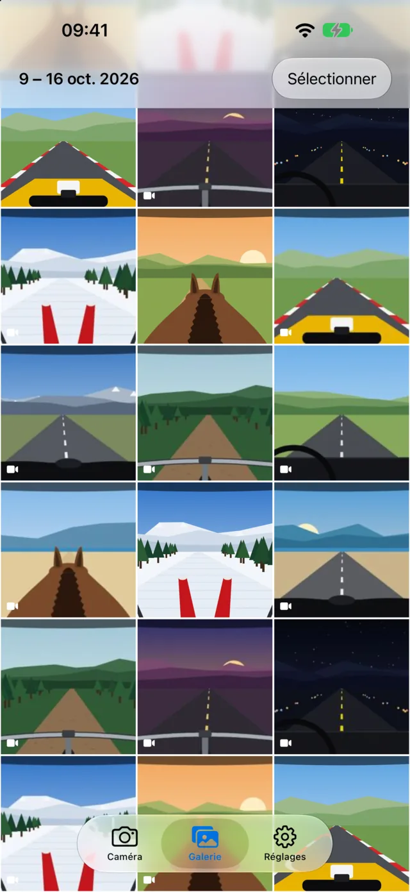
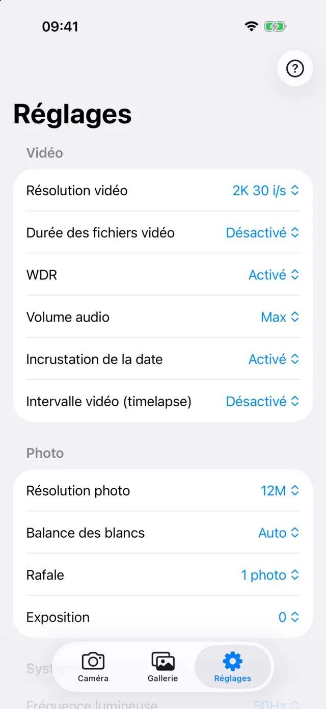

<p align="center">
  
</p>

<h1 align="center">Caméra Casque</h1>

<p align="center">
  Application iPhone et Android, libre et gratuite, <strong>compatible Cambox V3+ et V4</strong>.<br>
  Aperçu en direct, enregistrement, galerie et réglages de votre caméra casque.
</p>

<p align="center">
  <a href="https://cameracasque.fr/">Site</a> ·
  <a href="https://cameracasque.fr/#installer">Installer</a> ·
  <a href="https://github.com/nicocha/cameracasque/issues">Signaler un problème</a>
</p>

<p align="center">
  
  
  
</p>

## Pourquoi

Cambox a fermé et son application a disparu de l’App Store et de Google Play. Les caméras, elles, fonctionnent
toujours. Caméra Casque est une app indépendante, écrite de zéro à partir du protocole WiFi de la caméra
(Novatek pour la V3+, CGI pour la V4), pour que les possesseurs de Cambox puissent continuer à s’en servir :
sports équestres, sports mécaniques, karting, vélo, ski.

## Fonctions

- Aperçu en direct pour cadrer (désactivé au lancement, bouton œil sur l’image), enregistrement vidéo et photo à distance
- Galerie de la carte SD façon Photos : lecture, balayage entre les éléments, enregistrer dans Photos, partager, supprimer (sélection multiple)
- Tous les réglages de la caméra (résolution, durée des fichiers, WDR, exposition, WiFi…), batterie et firmware
- Modèle détecté automatiquement (V3+ ou V4) ; aide intégrée tirée des manuels V3+, V4 et V4 Pro
- Mode clair et sombre, VoiceOver, grandes tailles de texte, iPhone Duo (écrans extérieur et intérieur, pliage pendant la lecture)
- Aucune donnée collectée : l’app ne parle qu’à la caméra, sur son réseau WiFi

## Compatibilité

| | |
|---|---|
| Caméra | Cambox V3+ (firmware V1.26A testé), Cambox V4 / V4 Plus / V4 Pro (V4 Pro firmware 1.2.7 testé) |
| iPhone | iOS 16.4 ou plus récent |
| Android | Android 8 ou plus récent |

## Installer

- **Android** : test fermé Google Play, ouvert à tous. Rejoindre le groupe
  [Testeurs Caméra Casque](https://groups.google.com/g/testeurs-cameracasque), puis
  [l’invitation Google Play](https://play.google.com/apps/testing/com.nicocha.cameracasque).
- **iPhone** : TestFlight puis App Store, en préparation (compte développeur en cours d’activation).

Détails sur [cameracasque.fr](https://cameracasque.fr/#installer).

## Structure du dépôt

```
app/         l’application (Expo / React Native) — voir app/README.md
app/store/   fiches et captures App Store (ios/) et Google Play (android/)
docs/        le site web, publié par GitHub Pages (dossier /docs de la branche main)
```

## Compiler

```sh
cd app
npm install
npx expo run:ios --device       # iPhone branché
npx expo run:android --device   # téléphone Android branché
```

Builds de production et publication sur les stores : EAS (`app/eas.json`), détails dans `app/README.md`.

## Contribuer

Les tickets et les pull requests sont les bienvenus. Avant d’envoyer une modification :
`npx tsc --noEmit` et `node src/camera.check.ts` dans `app/`.

## Licence et marques

Code sous licence [MIT](LICENSE).

Caméra Casque est un projet indépendant, non affilié à Cambox Vision et non approuvé par elle.
Cambox® est une marque de Cambox Vision, citée uniquement pour indiquer la compatibilité.
Les manuels et les applications d’origine de Cambox ne sont pas distribués dans ce dépôt.
Photos des caméras sur le site : © Cambox Vision.
